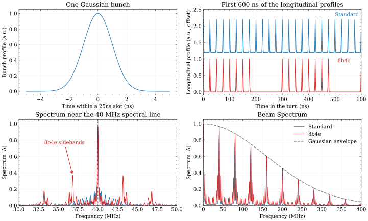

# Physics Manual

This section aims to provide the user with the basic physics behind the beam induced heating computation. For a more detailed explanation, we encourage the reader to check the references provided below.

## Introduction
When a particle beam passes into the vacuum chamber of an accelerator component, it will electromagnetically interact with its surroundings. One of the most critical effects that occur is heating due to the passage of the beam, known as Beam-Induced Heating (BIH) [^1].

As a result, an accurate design stage is required to account for this effect.

This code allows the calculation of heating due to Impedance effects in a high-current accelerator ring considering:
- one single beam in the vacuum chamber
- two counter rotating beams in the same vacuum chamber

The goal of this physics guide is to introduce the definition of all the quantities that are involved in the computation of BIH and to show the mathematical formulations that are implemented in the code.

## Wakefields and Impedances

The longitudinal wakefunction is defined as [^2]:

$$
w_z(x_s,y_s,x_t,y_t,s) = - \frac{1}{q_s q_t} \int_0^L F_z(x_s,y_s,s,x_t,y_t,z_t)dz_t
$$

 

Where, $q_s$ is the charge of the source particle, in position (x_s, y_s, z_s)), $q_t$ is the charge of the test particle particle in position (x_t, y_t, z_t), $s$ is the longitudinal distance between the two particles ($s = z_s - z_t$), $L$ is the accelerator component length and, $F_z$ is the longitudinal force acting on the test particle.

The longitudinal beam-coupling impedance is defined as the Fourier transform of the longitudinal wakefunction:

$$
Z_z(\omega) = \int_{-\infty}^{\infty} w_z(s) e^{\frac{-j\omega s}{v}} \frac{ds}{v}
$$

 

Where, $j$ is the imaginary unit, $\omega$ is the angular frequency conjugate variable of the time delay $\tau = \frac{s}{v}$ and, $v$ is the particle velocity.

## Beam spectrum

The longitudinal beam profile is the charge passing a fixed point during one turn. An FFT of this profile, normalized by its total charge, gives the beam spectrum $\Lambda(\omega)$ at harmonics separated by the revolution frequency $f_0$ [^8], named spectral lines. The **envelope** of these liens is set by the individual bunch profile: shorter bunches have more high-frequency content.

The filling pattern sets the **spectral lines** beneath that envelope. Bunches separated by the slot time $T_{\mathrm{slot}}$ reinforce lines near multiples of $1/T_{\mathrm{slot}}$ (40 MHz for 25 ns slots), while train gaps add nearby lines.

*SPS standard and 8b4e profiles with four trains, 25 ns slots, and Gaussian bunches of rms length $\sigma_t=1$ ns. The upper-right profiles are vertically offset; the FFTs cover the full 924-slot turn. The lower-right panel shows the strongest line per 1 MHz interval to reveal the envelope.*

The power-loss sum below weights each line by $|\Lambda|^2$ and by the real impedance at that frequency. A narrow impedance peak can therefore dissipate much more power when it coincides with a strong line; the [shifted power-loss scan](#power-loss-with-a-shifted-impedance) explores this sensitivity.

## Single Beam and Two counter rotating beams scenarios.
Single beam case [^3]:

$$
P_{loss} = 2 (f_0 eN_{beam})^2 \cdot \sum_{p=0}^{+\infty} |\Lambda(p\omega_0)|^2 Re[Z_z(p \omega_0)]
$$

 

Where, $f_0$ is the revolution frequency the machine, $e$ is the charge of the particle, $N_{beam}$ is the number of particles in the beam, $\Lambda$ is the normalized beam spectrum, $Re[Z_z]$ is the real part of the longitudinal beam-coupling impedance.

Case of two identical counter-rotating beams that are travelling in the same asymmetric vacuum chamber [^4]:

$$
P_{loss}(s) =
(2 f_0 e N_{beam})^2 \cdot \sum_{p=0}^{+\infty} |\Lambda(p\omega_0)|^2 \cdot (Re[Z^0_z(p \omega_0)] + \\
[\Delta y_1(s) + \Delta y_2(s)]Re[Z^1_z(p \omega_0)]) \cdot (1 - cos(p \omega_0 \tau_s))
$$

 

Where, $s$ is the location from the interaction point at which the power loss is being computed, $Z^0_z$ and $Z^1_z$ are the longitudinal impedances of order 0 and 1, $\Delta y_1(s)$ and $\Delta y_2(s)$ are the offsets from the geometrical center of respectively Beam 1 and Beam 2, $\tau_s = 2s/c$, with $c$ the speed of light, is the relative time delay of arrival at $s$ of the two beams.

## Power loss with a shifted impedance

The [beam spectrum](#beam-spectrum) supplies the spectral-line weights $|\Lambda|^2$ in the power-loss sum. Uncertainty in resonance frequencies can change how an impedance peak overlaps those lines, including the extra spectral lines from patterns such as 8b4e. `beam.getShiftedPloss(Z, shift=F)` scans a rigid frequency displacement of the entire real impedance. On the beam frequency grid, with spacing $\Delta f$, its power at integer step $k$ is

$$
P(k) = 2(f_0 e N_{beam})^2 \sum_{j: f_j \geq 0} |\Lambda(2\pi f_j)|^2 \operatorname{Re} Z_z\bigl(2\pi(f_j-k\Delta f)\bigr).
$$

The impedance is interpolated onto the beam grid before the scan and set to zero where the displaced samples fall outside that grid. A positive $k$ moves impedance features to higher frequencies. For $F\geq\Delta f$, the scan covers $k=-n,\ldots,n-1$, where $n=\lfloor F/\Delta f\rfloor$; the method returns these integer steps and their power losses in watts. Multiplying a step by $\Delta f$ gives its frequency offset. The largest and smallest returned values give the worst and best overlap within the chosen scan range. BIHC evaluates the full scan by cross correlation; all impedance features move together.

## About `bihc` python package
`bihc` is a computational package that integrates over a decade of experience in beam-induced heating calculations from the Impedance and Coherent Effects Section (see [^1], [^3], [^4], [^5], [^6], [^7]) into a comprehensive and flexible Python-based tool.

The package has been presented at the 68th ICFA Advanced Beam Dynamics Workshop on High-Intensity and High-Brightness Hadron Beam (0ct. 2023)[^8], and is under continuous development to face the beam-induce heating challenges that become more relevant as the beam total intensity and bunch length is pushed.

`bihc` has been succesfully employed to assess the mitigation strategy for the CERN-SPS Beam Wire Scanners after the wire failure in 2023, and was extensively used to study the CERN-LHC Warm Vacuum modules limitations in intensity and bunch length for the 2024 run.

[^1]: B. Salvant et al., “Beam induced heating”, 2012, [Online]. Available: https://cds.cern.ch/record/1975499

[^2]: Palumbo, L., et al. "Wake Fields and Impedance". 2003. DOI.org (Datacite), https://doi.org/10.48550/ARXIV.PHYSICS/0309023.

[^3]: C. Zannini, et al. "Power Loss Calculation in Separated and Common Beam Chambers of the LHC". Proceedings of the 5th Int. Particle Accelerator Conf., vol. IPAC2014, 2014, p. 3 pages, 1.928 MB. DOI.org (Datacite), https://doi.org/10.18429/JACOW-IPAC2014-TUPRI061.

[^4]: C. Zannini, "Electromagnetic Simulation of CERN accelerator Components and Experimental Applications", 2013. [Online]. Available: https://cds.cern.ch/record/1561199

[^5]: C. Zannini, “Multiphysics Simulations of Impedance Effects in Accelerators,” CERN Yellow Rep. Conf. Proc., vol. 1, pp. 141–144, 2018, doi: 10.23732/CYRCP-2018-001.141.

[^6]: G. Rumolo, “Beam Instabilities”, 21 pages contribution to the CAS - CERN Accelerator School: Advanced Accelerator Physics Course, Trondheim, Norway, 2014, doi: 10.5170/CERN-2014-009.199. Available; https://cds.cern.ch/record/1982422

[^7]: F. Giordano, ‘Simulation Analysis and Machine Learning Based Detection of Beam-Induced Heating in Particle Accelerator at CERN’, University of Naples Federico II, 2020.

[^8]: E. de la Fuente, L. Sito, F. Giordano, G. Rumolo, B. Salvant, and C. Zannini, “A Python Package to Compute Beam-Induced Heating in Particle Accelerators and Applications,” in Proc. 68th Adv. Beam Dyn. Workshop High-Intensity High-Brightness Hadron Beams (HB’23), Geneva, Switzerland, Apr. 2024, no. 68, pp. 611–614. doi: 10.18429/JACoW-HB2023-THBP52.
